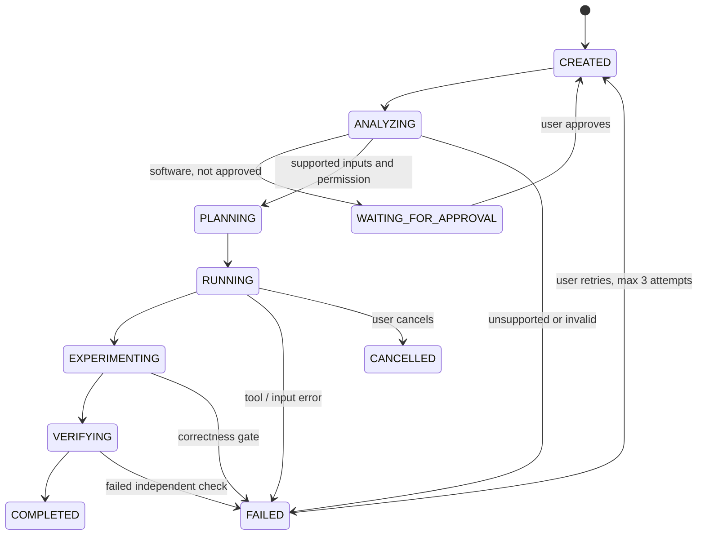

# Architecture

## Data and execution

React/TypeScript → Vite same-origin `/api` proxy → FastAPI → SQLite + artifact files. One polling worker consumes CREATED missions. SQLite WAL persists mission documents, append-only event records, and skill versions/evaluations. A per-store lock serializes read-modify-write operations inside the single worker process. This does not support multiple API workers or distributed scheduling.

`backend/praxis/store.py` owns persistence; `api.py` owns request validation and control actions; `engine.py` orchestrates adapters and durable checkpoints; `sandbox.py` runs trusted generated tests; `templates.py` defines bounded calculator synthesis; `integrations.py` handles optional provider discovery/proposals.

## State machine

Cancellation is allowed in any nonterminal state, including approval waits. Execution checks deadlines/cancellation between stages and during the Docker process wait. A sandbox deadline kills/removes the named container. Each plan node lists dependency indexes; the scheduler refuses to start a node until its dependencies complete. Current adapter DAGs are linear, dynamically selected by domain, rather than arbitrary model-generated graphs. Extending a domain means adding a validated tool definition, adapter, test contract and frontend input schema.

## Evidence and decisions

Each evidence record has an ID, title, exact content, source locator, observed timestamp, SHA-256 digest, uncertainty and typed relationships. Research source publication timestamps are supplied metadata, not authenticated dates. Numeric discrepancies link back to both conflicting sources. `GET /api/evidence?q=` searches persisted source/output records across mission history.

Decision records contain the objective, considered alternatives, selected action, explicit constraints, linked evidence IDs, execution result, verification reference, and remaining uncertainty. They are concise observable rationales; no hidden chain-of-thought is collected or fabricated.

## Experiments and skills

Software tests both a limited baseline and restricted AST candidate against identical cases. Data compares robust detection on a labeled synthetic fixture and validates separately on a held-out fixture; uploaded-data aggregates have an independent Python reference check. Research measures lexical retrieval coverage, retaining failure/limitations without treating coverage as truth.

Software/data procedures have a version, structured strategy identifier, preconditions, tests, history and per-mission evaluations. A later mission loads the persisted strategy before execution and reruns the full verification on its own inputs. Failed transfers are retained. Procedure changes increment the version when a newly verified strategy is saved. No training weights change; no universal transfer claim is made.

## Rendering

Three.js is lazy-loaded. The original landing object is a metallic torus-knot sculpture with sparse orbital markers. Mission graph nodes are constructed from actual persisted objectives, tasks, tool adapters, evidence, decisions, experiments, artifacts and skills. Edges map dependencies/provenance or mission ownership. OrbitControls supply zoom and rotation; raycasting selects a node. A parallel keyboard node list provides the same inspection data. Selected node details are rendered as text, never HTML.

Reduced motion stops automatic rotation. The renderer caps pixel ratio at 1.5 and frames at 30 fps, pauses offscreen/in background, and disposes geometry/materials/controls/renderer on teardown. A WebGL initialization failure displays a text fallback while the node list remains available. Scene complexity is bounded by input limits; no GPU performance benchmark across devices is claimed.

## Trust boundaries

No user-provided commands or generated model code are run. Calculator expression evaluation whitelists bounded AST nodes and arithmetic, rejecting calls, attributes, powers and imports. Tool execution is approval-gated; Docker receives only a read-only per-mission directory and no application secrets. Inference credentials stay in the API environment, errors are sanitized, and redirects are disabled to avoid forwarding credentials to a redirected host. HTTP is allowed only for loopback inference; remote services require TLS.

Artifacts are allowlisted against the mission manifest, served as downloads with nosniff, and identified by digest. The local UI is unauthenticated by design and must not be publicly exposed. Current host API processes can access their configured filesystem; this is not a hostile multi-user sandbox. Secrets in user-submitted documents are not automatically discovered/redacted: do not upload credentials.
